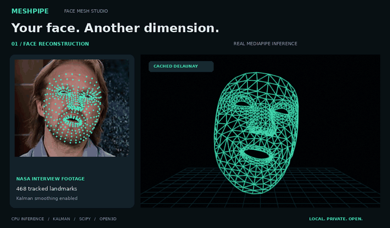
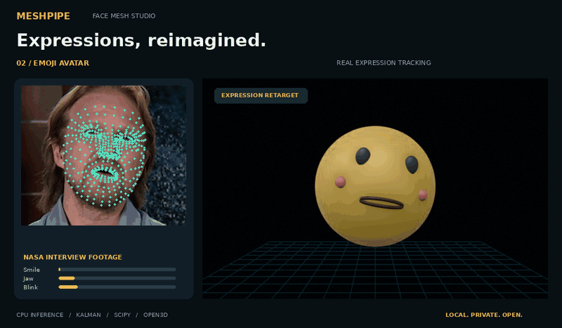
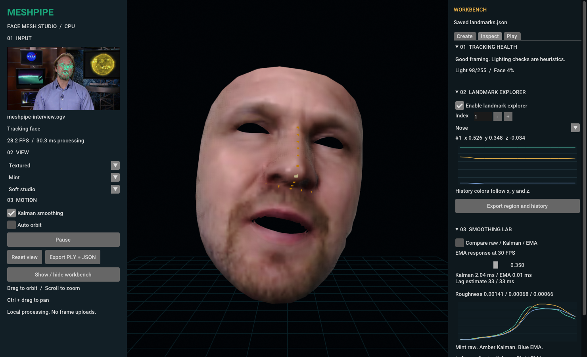

# MeshPipe

### Your face. Another dimension.

A CPU-first facial mesh studio. Track a face from a webcam or video, calm noisy
landmarks with a Kalman filter, and explore the result in an interactive 3D view.
Record performances, inspect motion, or drive an emoji and your own PNG puppet.




Real MediaPipe detection on recorded NASA interview footage with speech,
blinks and natural head motion. Both showcases use video, not animated stills.
The surrounding layout is a documentation presentation of pipeline output,
not a desktop screenshot. [Showcase details](docs/showcase.md).

## A small studio with a lot to explore

- **Live or recorded** with webcam indices and local video files, including looping.
- **Stable geometry** with 468 landmarks, vectorized Kalman smoothing and cached SciPy triangulation.
- **Seven views** with surface, wireframe, points, source color, UV texture, emoji and cartoon modes.
- **Hands-on 3D** with drag-to-orbit, scroll-to-zoom, pan, reset and automatic orbit.
- **Expression retargeting** with a built-in emoji driven by smile, jaw and blink scores.
- **Useful exports** with colored PLY meshes and JSON landmarks, expressions and topology.
- **Local by default** with no frame uploads, accounts or background model downloads.

## Create. Inspect. Play.

The workbench adds ten ways to explore facial motion without replacing the
lean tracking pipeline. Recording, streaming, calibration, lab and game tools
stay opt-in. Hide the workbench when you only need the viewer.

| Tool | What you can do |
| --- | --- |
| Your cartoon | Load a PNG, mark both eyes and mouth, then animate a 2D puppet |
| Performance recorder and replay | Save frames and facial motion, then seek, pause, loop or change speed without inference |
| Local avatar stream | Send OSC expressions and approximate head rotation to Blender |
| View recorder | Record the current source and rendered model together as GIF or MP4 |
| Personal calibration | Capture neutral and comfortable expression ranges, then tune response |
| UV texture | Map the actual video frame onto the deforming face surface |
| Smoothing lab | Compare raw, Kalman and EMA geometry, costs and motion histories |
| Landmark explorer | Pick vertices, highlight regions and export coordinate histories |
| Tracking health | Check framing and lighting with a short fade during face loss |
| Expression playground | Match smiles, jaw movement, winks and head turns with keyboard fallback |

[Workbench guide](docs/workbench.md) and [Blender receiver](docs/streaming.md)
cover setup and limitations.

```bash
meshpipe run --replay exports/performance.meshpipe --loop
meshpipe run 0 --cartoon character.png
meshpipe run 0 --osc-port 9000
python tools/build_blender_addon.py
```

Performance files contain full source images and facial data. Keep them private
unless every recorded person agrees to sharing. Local recordings and exports
are ignored by Git.

## Get started

Use Python 3.10, 3.11 or 3.12 in a desktop environment with working OpenGL.

```bash
git clone https://github.com/IlyaKhalafi/MeshPipe.git
cd MeshPipe
python -m venv .venv
source .venv/bin/activate
python -m pip install -e .
meshpipe --demo
```

On Windows, activate with `.venv\Scripts\Activate.ps1` in PowerShell.
The demo needs neither a webcam nor the detection model. Its motion is synthetic.

### Track a webcam

```bash
meshpipe download-model
meshpipe 0
```

The model comes from Google's official storage and passes SHA-256 verification.
It is cached outside the repository. Download once, then process offline.
Use `meshpipe 1` for a second camera, subject to your OS camera enumeration.

### Open a video

```bash
meshpipe path/to/video.mp4
meshpipe path/to/video.mp4 --loop
meshpipe path/to/video.mp4 --model path/to/face_landmarker.task
```

Files retain their frame timestamps. When playback ends, the last frame remains
available for inspection and export. Webcam capture keeps only the newest
pending frame instead of building a delayed queue.

## Make a face, move an emoji



Select **Emoji** in the studio to drive the avatar from detected expressions.
This GIF uses the same recorded interview as the mesh showcase. Its mouth and
eyes follow expression scores detected from the actual video frames.

The avatar follows head orientation and maps facial expression scores to its
eyes and mouth. It is a built-in stylized rig, not a tool that turns arbitrary
cartoon images into 3D faces.

## Studio controls



Actual desktop interface running the recorded interview. Source texture follows
raw landmarks while geometry uses the selected smoothing.

| Control | Behavior |
| --- | --- |
| Left drag | Orbit the camera around the model |
| Scroll | Zoom |
| Ctrl + left drag | Pan |
| View menu | Surface, Wireframe, Points, Source Color, Textured, Emoji or Cartoon |
| Lighting menu | Soft studio, Flat or Dramatic |
| Palette menu | Mint, Amber or Cloud |
| Kalman smoothing | Toggle temporal filtering without restarting |
| Auto orbit | Rotate the camera automatically |
| Pause | Freeze processing and retain the current view |
| Reset view | Return to the front camera |
| Export PLY + JSON | Save the current face to `exports/` |
| Workbench tabs | Create recordings, inspect landmarks or play expression targets |
| Shift + left click | Pick a vertex when landmark explorer is enabled |

Exports contain the reconstructed face mesh and sampled source colors, regardless
of the selected presentation mode. Emoji geometry is not exported.

Pause stops inference. Webcam capture stays active so resuming uses a recent
frame rather than buffered old frames. Close the studio to release the camera.

## Built for CPU, measured honestly

Inference explicitly uses MediaPipe's CPU delegate. Open3D rendering still needs
a working graphics stack, or a configured software renderer.

The pipeline triangulates once, filters coordinates in NumPy batches, downsizes
large frames and moves inference off the GUI thread. Single-slot mailboxes keep
webcam and result buffers bounded. No per-landmark Python filter objects.

```bash
meshpipe 0 --width 480 --max-fps 30
meshpipe 0 --width 320 --max-fps 20
meshpipe benchmark video.mp4 --frames 300 --warmup 10 --output benchmark.json
```

A local run processed genuine recorded interview footage at **48.07 FPS**
on an Intel Core i7-9750H with CPU inference and Kalman smoothing. All 300 measured
frames contained a detected face at 640 by 360. Headless throughput is not webcam
or desktop FPS. It excludes rendering, display pacing and model startup.
Hardware and inputs change results. [Measurement details](docs/performance.md).

`--width` is a maximum, not an upscaling target. Smaller frames reduce inference
work but may lose fine expressions. `--max-fps` caps studio processing;
benchmarks intentionally run without that cap. `--no-smoothing` disables Kalman.

Studio FPS reports processing cadence, not monitor refresh. The viewer consumes
the newest completed frame so slow rendering does not create a stale queue.

## Know the limits

- One face at a time. Extra iris points are not part of the 468-vertex mesh.
- Monocular depth is relative, not a metric scan or medical measurement.
- The face is an open surface, not a complete head or watertight printable object.
- Extreme profiles, occlusion and poor lighting can break tracking.
- Source Color interpolates landmark colors, not a full UV texture.
- Textured mode projects the current source image, not a persistent texture atlas.
- PNG cartoons use image warping, not automatic cartoon recognition or 3D reconstruction.
- Expression scores and quality hints do not classify emotions or diagnose conditions.
- Video decoding stays sequential. Slow processing slows playback; slow rendering may skip display updates.

## Troubleshooting

| Symptom | What to try |
| --- | --- |
| Model not found | Run `meshpipe download-model` or supply `--model` |
| Camera cannot open | Close other camera apps, grant OS permission and try another index |
| No face detected | Improve lighting, face the camera and increase `--width` |
| Blank window or OpenGL error | Update graphics drivers and run on a desktop display |
| Slow CPU | Try `--width 320 --max-fps 20` and close competing workloads |
| Unsupported Python wheel | Use Python 3.10 through 3.12 on a supported 64-bit desktop OS |

Native desktop and real video smoke tests were run on Linux. Windows and other
hardware still need field testing. Headless detection and desktop rendering have
different system requirements. Open3D offscreen GIF generation needs EGL on Linux.

## Under the hood

```text
Capture  |  MediaPipe  |  Kalman  |  SciPy topology  |  Open3D
```

Core processing has no GUI dependency. Capture, inference, filtering, geometry,
rendering and exports live in separate modules. Tests cover filter stability,
face loss, toggles, video EOF, looping timestamps, exports and download failures.
Additional tests cover session replay, media encoding, calibration, bounded
OSC packets and Blender shape-key preservation.

[Architecture](docs/architecture.md) | [Contributing](CONTRIBUTING.md) |
[Asset credits](THIRD_PARTY.md) | [License](LICENSE)

MeshPipe code is MIT licensed. Third-party models and assets retain their own
terms. Check [asset credits](THIRD_PARTY.md) before redistributing them.
